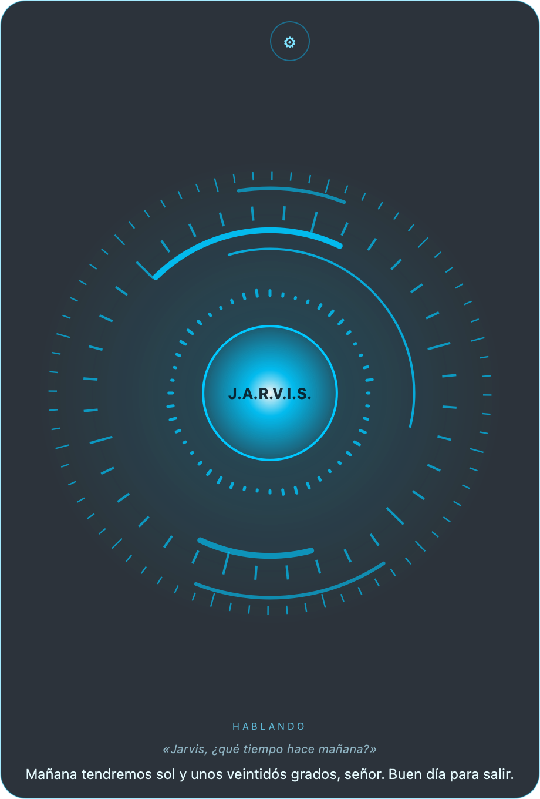

# J.A.R.V.I.S. (Spanish voice assistant)

[Español](README.md)

A voice assistant that speaks Spanish (Spain), for Windows, macOS and Linux. Its brain is DeepSeek, which costs a few cents a day. The interface and the voice are in Spanish.

## Features
- **Voice**: say "Jarvis…", press Ctrl+Alt+J or click the circle. It speaks with neural voices (edge-tts).
- **Computer**: opens websites and apps, changes volume and brightness, controls media, sets alarms and reminders.
- **Memory**: remembers what you tell it and searches past conversations.
- **Key vault**: passwords and tokens encrypted with a master passphrase. The AI only sees their names, never their values.
- **Phone**: talk to it from Telegram or WhatsApp, by text or voice notes. It sends you alerts there too.
- **Several computers**: one Jarvis shared by several machines, with the same memory and vault. One machine leads, and another takes over automatically if it goes off.
- **ESP32 / PlatformIO**: builds and uploads firmware, opens the serial monitor and writes `secrets.h` with your Wi-Fi.
- **MQTT**: reads sensors and sends commands, for example to an irrigation system.
- **LG webOS TVs**: turns them on, opens apps, sets the volume and shows on-screen notices.
- **Claude Code** (optional): hands it questions or programming tasks.
- **Obsidian notes**: "apunta en notas que…" ("note down that…").

## Install

You need a [DeepSeek](https://platform.deepseek.com/) API key.

- **Windows**: run `instalar.bat`. It installs Python 3.12 if needed and opens `.env` for your key. Then start Jarvis with `iniciar_jarvis.bat`.
- **macOS**: in Terminal, run `bash instalar_mac.command` and paste your key when asked. Then open **Jarvis** from Spotlight. Allow the microphone and, for the shortcut, Accessibility.
- **Linux**: run `bash instalar_linux.sh`, then `bash iniciar_linux.sh`.

All other settings are optional and described in [`.env.ejemplo`](.env.ejemplo).

## License
**Free for personal and other noncommercial use** under the [PolyForm Noncommercial License 1.0.0](LICENSE.md).

**Commercial use** needs a paid commercial license. That covers selling it, bundling it in a paid product or service, or using it in a business. Contact me on [GitHub](https://github.com/Iklavid).

This license restricts commercial use, so it is not "open source" under the OSI definition. The source code is still public.

## Support
If you find it useful, you can buy me a coffee: (GitHub Sponsors or Ko-fi link).

## Credits
The original idea comes from [jarvis-ai-assistant](https://github.com/AnubhavChaturvedi-GitHub/jarvis-ai-assistant) by Anubhav Chaturvedi. The code in this repository is a rewrite.
