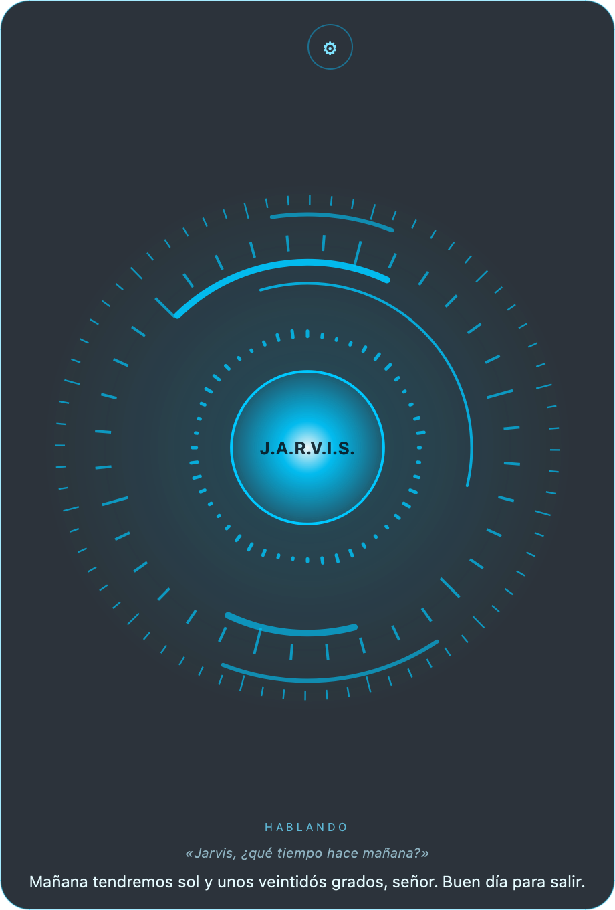

# J.A.R.V.I.S. en español

[English](README.en.md)

Asistente de voz en español de España para Windows, Mac y Linux. Usa DeepSeek como cerebro, que gasta muy poco: unos céntimos al día.



## Qué hace
- **Voz**: le dices «Jarvis…», pulsas Ctrl+Alt+J o haces clic en el círculo. Habla con voces neuronales (edge-tts).
- **Ordenador**: abre webs y programas, cambia el volumen y el brillo, controla la música, pone alarmas y recordatorios.
- **Memoria**: recuerda lo que le cuentas y busca en las conversaciones de otros días.
- **Bóveda de claves**: guarda contraseñas y tokens cifrados con una frase maestra. La IA solo ve los nombres, nunca los valores.
- **Móvil**: puedes hablarle por Telegram o por WhatsApp, con texto o notas de voz, y te manda los avisos.
- **Varios equipos**: un solo Jarvis en varios ordenadores que comparten memoria y bóveda. Uno hace de principal y el relevo es automático.
- **ESP32 y PlatformIO**: compila, sube el firmware, abre el monitor serie y crea `secrets.h` con la WiFi.
- **MQTT**: lee sensores y manda órdenes, por ejemplo a un sistema de riego.
- **Teles LG webOS**: las enciende, abre apps, cambia el volumen y saca avisos en pantalla.
- **Claude Code** (opcional): le pasa preguntas o tareas de programación.
- **Notas en Obsidian**: «apunta en notas que…».

## Instalar

Necesitas una clave de API de [DeepSeek](https://platform.deepseek.com/).

### Windows
1. Descarga el repositorio o clónalo, por ejemplo en `C:\Users\<tú>\Proyectos\Jarvis\programa`.
2. Haz doble clic en `instalar.bat`. Instala Python 3.12 si falta, crea el entorno y abre el `.env` para que pegues la clave de DeepSeek.
3. Para abrirlo, usa `iniciar_jarvis.bat`; si quieres ver los errores, `iniciar_con_consola.bat`.
4. Para que arranque con Windows: clic derecho en Jarvis → **Iniciar con Windows**.

### Mac
1. Abre Terminal, escribe `bash ` con un espacio al final, arrastra `instalar_mac.command` a la ventana y pulsa Enter.
2. Pega la clave de DeepSeek cuando te la pida.
3. Abre **Jarvis** desde Spotlight. Acepta el permiso del micrófono y, para el atajo de teclado, da permiso en Ajustes del Sistema → Privacidad → Accesibilidad.

### Linux (probado en KDE)
```bash
bash instalar_linux.sh
bash iniciar_linux.sh
```

### Primeros pasos
- Clic derecho → **Bóveda de claves**: crea tu frase maestra.
- Telegram: crea un bot con @BotFather y guarda el token en la bóveda con el nombre `Telegram bot`. Luego, clic derecho → **Emparejar móvil**.
- El resto de ajustes, todos opcionales, están explicados en [`.env.ejemplo`](.env.ejemplo).

## Varios equipos
Pon la carpeta en una carpeta sincronizada, por ejemplo con Syncthing:
- `programa/` lleva el código.
- `datos/` guarda la memoria, la bóveda cifrada y las conversaciones.

Cada equipo tiene además su `local.env` con `EQUIPO` y `PRIORIDAD`. Los equipos se avisan por MQTT, así que hace falta un broker como Mosquitto.

## Privacidad
- Tus datos se quedan en tu carpeta `datos/`, que nunca va a Git.
- A DeepSeek solo le llega lo que le dices y lo que Jarvis recuerda de ti.
- Las claves van cifradas con tu frase maestra, y la clave local se guarda en el llavero del sistema.

## Licencia
**Uso personal y no comercial gratuito** bajo la [PolyForm Noncommercial 1.0.0](LICENSE.md): puedes usarlo, estudiarlo, modificarlo y compartirlo sin ánimo de lucro.

**Uso comercial**: venderlo, incluirlo en un producto o servicio de pago, o usarlo en una empresa necesita una licencia comercial de pago. Escríbeme por [GitHub](https://github.com/Iklavid) para pedirla.

Esta licencia no es «open source» según la definición de la OSI, porque limita el uso comercial. El código sigue siendo público.

## Apoyar el proyecto
Si te es útil, puedes invitarme a un café: (enlace de GitHub Sponsors o Ko-fi).

## Créditos
La idea inicial viene de [jarvis-ai-assistant](https://github.com/AnubhavChaturvedi-GitHub/jarvis-ai-assistant), de Anubhav Chaturvedi. El código de este repositorio está escrito de nuevo.
